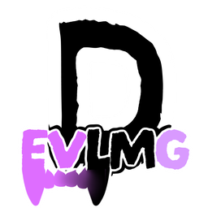
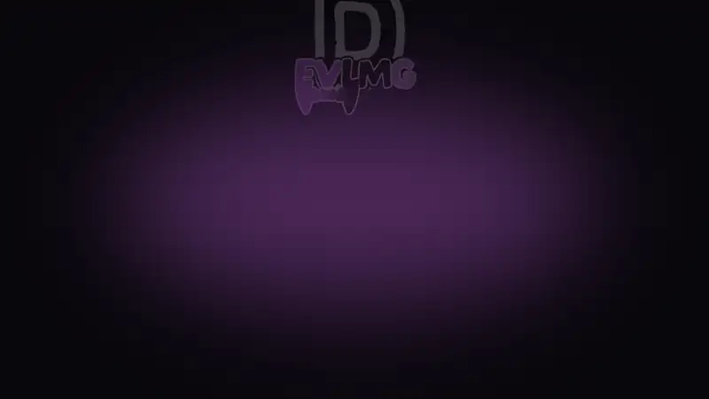
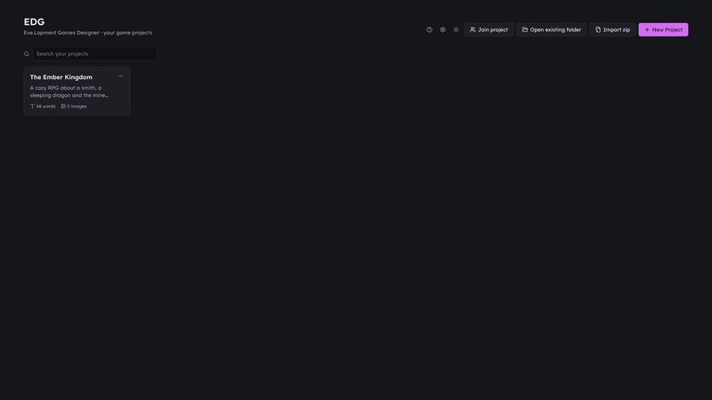

<p align="center">
  
</p>

<h1 align="center">Eve.Lopment Games Designer</h1>

<p align="center"><i>EVLMG Designer for short</i></p>

<p align="center">
  
</p>

<p align="center">
  <a href="https://github.com/Evelynnsrepos/EVLMG-Designer/releases/latest"><b>⬇ Download</b></a> ·
  <a href="#-crash-course">Crash course</a> ·
  <a href="#-install">Install</a> ·
  <a href="#-git-sync">Git sync</a> ·
  <a href="#-all-the-tools">All the tools</a> ·
  <a href="#-for-developers">For developers</a>
</p>

<p align="center">
  <a href="https://discord.gg/AGfaBwNKfN"></a>
  <a href="https://www.youtube.com/@EvelopmentGames"></a>
  <a href="https://www.instagram.com/evelopmentgames/"></a>
  <a href="http://onee.page/evelopmentgames"></a>
  
</p>

<p align="center">
  <a href="https://ko-fi.com/evelynnevlmg"></a>
</p>

<p align="center">
  <a href="docs/media/evlmg-showcase.mp4"></a>
  <br>
  <a href="docs/media/evlmg-showcase.mp4">▶ Watch the video with sound</a>
</p>

<p align="center"><b>One program for designing your whole game.</b></p>

Story, lore wiki, characters, towns, items, enemies, maps, levels, timelines, drawings, mood boards and balancing
calculators all live in one project, and they all know about each other. Free, offline, for Windows, macOS and Linux.

- 🧩 **Everything in one place.** No more juggling a wiki here, a spreadsheet for drop rates there and a whiteboard
  app somewhere else. An item you create can be linked from the Wiki, dropped by an enemy and counted by the
  Resource Calculator.
- 🎨 **Your ideas, made by you.** No AI-generated art or stories: the app never writes stories or makes images for you.
  The optional small helpers are for spell checking and searching only: they check spelling and grammar and search
  your own notes, on your own computer. They are off until you turn them on, and they never write anything for you.
- 🔓 **Fully open source.** The app is [GPL-3.0](LICENSE), and everything it is built from is open source too: all
  libraries (MIT, Apache-2.0, BSD, ISC, MPL-2.0, GPL-3.0 and similar), the English (SCOWL) and German (igerman98,
  GPL) spell check dictionaries, and the optional helper downloads (llama.cpp, MIT, and Qwen models, Apache-2.0).
  No closed part, no account, no tracking.
- 🏠 **Your data stays yours.** Projects are normal folders on your computer. Nothing is uploaded, nothing is used
  for training.

> [!WARNING]
> ### 🚧 Under construction 🚧
> Every tool works, but this is early development: expect rough edges, and the project format may still change.
> **Your ideas shape what gets built next.** Found a bug, missing a tool, or have an idea?
> Please [open an issue](https://github.com/Evelynnsrepos/EVLMG-Designer/issues/new) or come say hi on
> [Discord](https://discord.gg/AGfaBwNKfN). Every suggestion gets read.

## 🛠 Crash course

The whole app in five minutes.

1. **Start a project.** The launcher shows all your games. Click **New project** and pick a preset (RPG, action,
   roguelike, strategy, visual novel, gacha, cozy, or just writing, drawing, worldbuilding, levels, a tabletop
   campaign or a pitch). You get the right tools, a vision page with pillars and a starter task list.
2. **Open tools from the sidebar.** **Click** a tool to show only that tool, **Shift-click** to open it next to the
   ones already open, or **drag** it onto the screen to split it. Need another tool? **Add tool** at the bottom of the
   sidebar has a search.
3. **Organize the sidebar.** Search it, star favorites so they stay on top, drag tools into your own order, and
   right-click a tool for colors, folders and closing it.
4. **Rearrange with `Esc`.** Layout Mode shows big, easy targets to close, swap or move tool windows.
5. **Hold `Q` for the Hotwheel.** A round menu under your pointer or pen: program actions inside, the current tool's
   actions outside. Point and let go. Every tool's header also has its shortcuts and a size button for tablets.
6. **Jump points.** The crossing-arrows button in every tool's header links it to any other tool, document or entry,
   and lists what points back. On boards, the jump tool (`J`) places a jump point right on the board. Drag a jump point
   out of the list onto a board, into any text (it becomes a `[[link`) or onto an entry's Jump to bar.
7. **Link everything.** Write `[[` in any text to link an article, entry, tool or document. Every entry
   shows what it points at and where it is used, one click away. Jump around and come back with `Alt+Left` and
   `Alt+Right`.
8. **Find anything with `Ctrl+K`.** Tools, documents, items, characters, towns, enemies, wiki articles and commands.
9. **Don't worry about saving.** The app saves about a second after every edit, every tool has undo and redo, and the
   last 10 saves are kept as backups.
10. **Stuck?** Press `F1` for the built-in guide to every tool. The tour on first launch walks you through the basics.
11. **Ship it.** Turn the project into one game design document (**Design Book**, web page or PDF), or send items,
   characters, towns, enemies, quests, dialogue and translations to **Godot 4, Unity or Unreal**, or as JSON.

<details>
<summary><b>More things worth knowing</b></summary>

- **Work together**: share a project with an invite code and edit it live with others, peer to peer, on Windows, Mac
  and Linux. No account needed; offline changes merge when you reconnect.
- **Work through a server** (optional): put a project on your own
  [EVLMG Designer Server](https://github.com/Evelynnsrepos/Evelopment-Games-Designer-Server) so people can
  join and sync even when nobody else is online. Each person gets their own connect code, for editing or view only,
  and the server can offer plugins.
- **Git sync** (optional, one person): every project gets its own private GitHub repository, or use GitLab, Gitea,
  Codeberg or your own server. It gets the latest version when the project opens and saves in the background when you
  leave it, so you can move between your own computers. Import from Git on the start screen downloads it on a new
  computer. A shared project can instead get a push-only Git backup by one member.
- **Search everywhere**: find projects on the start screen, presets and tools when you make a project, and any
  setting in the Settings search.
- **Project folders**: sort the start screen into your own folders (Games, YouTube videos, Writing…), with your
  recent projects in one row.
- **Your own project presets**: save the tools you picked as a preset, or make and edit presets in Settings.
- **Your drawings everywhere**: wherever you add a picture, your drawings from Draw are offered first, like stickers.
- **Review status and comments** on every tool window and entry, from Idea to Final, with a Reviews board.
- **Custom categories** (like *Element* or *Faction*) are made once and used on items, characters, towns and enemies.
- **Rarities**: as many rarity systems as you like (Rarity, Tier, Quality…) with colors, borders, icons or your own
  pictures, star or number ratings, and your own fields like drop rates.
- **Safe deleting**: before you delete something, the app shows every place it is used. Links follow renames.
- **Looks**: light and dark themes, a Project look per project (accent, background, wallpaper), a project picture,
  and a font for every tool.
- **Spell check** in English and German with your own word list; names from your project count as correct.
  The optional grammar helper comes in Small (1.1 GB), Better (2.5 GB) and Best (4.7 GB).
- **Export a project as a zip** and import it again, for backups or to send to someone.
- **Plugins** add new tools: install one from a GitHub link or a zip in Settings.
- **Settings with tabs and search**: General, Writing, Keys & Hotwheel, Project presets, Git and Plugins.
- **Your own shortcuts**: change any key in Settings; the user guide (`F1`) has a cheatsheet with the default and your key.

</details>

| | |
|---|---|
|  |  |
| **Story Branch Writer**: branching stories as a mind map | **Timeline**: history with alternative branches |
|  |  |
| **Brainstorm Board**: notes, pins, string and areas | **Launcher**: all your game projects at a glance |
|  |  |
| **Guided tour** on first launch | **User guide** for every tool, built in (F1) |

## ⬇ Install

Grab the file for your system from the
[Releases page](https://github.com/Evelynnsrepos/EVLMG-Designer/releases/latest):

| System | File |
|---|---|
| 🪟 Windows | `*_x64-setup.exe` |
| 🍎 macOS (Apple Silicon and Intel) | `*_universal.dmg` (read [Mac](#mac) below first) |
| 🐧 Linux | `*.AppImage` (any distro), `*.deb`, or `*.flatpak` (any distro with Flatpak, NixOS too) |

> [!NOTE]
> EVLMG Designer used to be called *Evelopment Games Designer*. Installers, download files and the installed app still carry
> that name for now, so updates find your existing install and your projects stay where they are.

**Flatpak:** `flatpak install Evelopment.Games.Designer_<version>_x86_64.flatpak`.
On NixOS, turn Flatpak on first with `services.flatpak.enable = true;` in your system configuration.
Drawing slow or the window blank? Settings, General, Drawing speed shows if the graphics card is used and has a
drawing test, plus a graphics mode switch for drivers that don't work well.

**Arch Linux:** `makepkg` builds and installs it as a normal package, with a menu entry and
`pacman -R evelopment-games-designer` to uninstall:

```bash
sudo pacman -S --needed git base-devel
git clone https://github.com/Evelynnsrepos/evelopment-games-designer.git
cd evelopment-games-designer/packaging/arch
makepkg -si
```

### Mac

The app is not signed with a paid Apple developer certificate, so macOS refuses to open it the first time:

1. Open the `.dmg` and drag the app into **Applications**.
2. Open the app once. macOS says it can't be opened. Click **Done** (or **Cancel**).
3. Go to **System Settings → Privacy & Security**, scroll down and click **Open Anyway** next to
   *Evelopment Games Designer*, then confirm.

If macOS says the app "is damaged and can't be opened", that's the download quarantine flag. Clear it in Terminal:

```bash
xattr -dr com.apple.quarantine "/Applications/Evelopment Games Designer.app"
```

## 🔄 Git sync

Use the app on more than one computer, or keep your project's history safe on GitHub. Git sync keeps a project in
your own Git repository, using the Git installed on your computer and your own login. Nothing goes through us.

- **Connect GitHub** once, and every project gets its own **private** repository (`egd-<project name>`) by itself.
- It **gets the latest version** when a project opens and **saves to Git** in the background when you leave it.
  *Sync to Git* and *Sync from Git* do it right away, and a Git mark on the start screen shows each project's state.
- **Import from Git** on the start screen lists your GitHub projects (no address needed when Git is logged in) and
  downloads one, or all that are not on this computer yet.
- **Private only**: Git sync refuses public repositories on every host. One project can allow a public repository in
  its Git sync window, after a red warning.
- **Other hosts**: GitLab, Gitea, Forgejo, Codeberg or your own server work too. *Settings → Git* has login help,
  an address check, and your own branch, commit message and extra Git settings.
- It **never mixes versions**: if you changed a project on two computers without syncing, it asks which one to keep
  and backs up the other.
- **For one person only.** To work on a project together, use *Work together* or a server. A shared project can
  still get a push-only Git backup from one member.

**Setting it up** takes about 10 minutes, once:

1. Install [Git](https://git-scm.com/downloads) (free).
2. Make a free [GitHub account](https://github.com/signup).
3. Log Git in to GitHub once. On Windows, Git shows a sign-in window by itself the first time. On Mac and Linux,
   install [GitHub CLI](https://cli.github.com) and run `gh auth login` in a terminal.
4. In the app, open a project, click **Git sync** in the sidebar and click **Connect GitHub**. That's it.

Using another host? Make an empty, private repository there and paste its address under *Use my own repository
address instead* in the Git sync window.

The Git sync window and the user guide (`F1`) walk you through every step, explain each error message and link to
beginner guides.

## 🧰 All the tools

51 tools, and you only add the ones your game needs.

<details>
<summary><b>Click to see every tool</b></summary>

#### 📋 Lists and world

| Tool | What it does |
|---|---|
| **Item List** | Every item in your game, with images, rarity, value, stats and your own custom categories. Shows which enemies drop each item. |
| **Character List** | Characters with portraits, family, nation, clan, race and links to other characters. |
| **Town List** | Towns with nation, race, religion and links. Cities placed on a map are towns. |
| **Enemy List** | Enemies with combat stats, growth per level, resistances, drop tables and where they are found. |
| **Wiki** | Articles with `[[links]]`, articles made from any item, character, town or enemy (with a live info box), backlinks and a connection map. |
| **Factions** | Factions with leaders, members and towns, and a matrix of how they feel about each other. |
| **Family Tree** | Characters from the Character List as a family tree with parents, children and partners. |
| **Map Creator** | Cities, streets, terrain stamps and zones (like the land of a faction) on a blank map, with PNG export. Cities are linked to the Town List; zones link to factions, characters, documents and more. |
| **Cosmos Creator** | Universes, galaxies, solar systems, planets, moons and more in an isometric view, with your own pictures for any body. |
| **Names & Languages** | Generate names in about 50 real-world styles (German, Polish, Japanese…) or from a made-up language's sounds, and build that language with a dictionary and translator. |
| **Calendar & Eras** | Your world's months, weekdays and eras, a month view and a date calculator; timelines show era years. |
| **History** | Earlier versions of items, characters, towns and enemies: compare what changed and restore. |

#### ✍️ Story and writing

| Tool | What it does |
|---|---|
| **Writer** | Rich text documents for design docs, scripts and dialogue, with fonts and sizes, images you can size and let the text flow around, live word count, Markdown/text export and Markdown import. A per-document Markdown Syntax switch adds typing shortcuts like `==highlight==`, `- [ ]` checklists, `> [!note]` callouts, tags, footnotes and tables, and turns pasted Markdown into formatting. |
| **Story Branch Writer** | Mind-map style branching stories: create, branch, connect and sever nodes. Double-click a node to type its title and story text right on it. |
| **Timeline** | Timelines with optional years, events with images, and branches for alternative histories (press `B`). |
| **Quest Designer** | Quests with givers, places, objectives, rewards and chains shown as a graph, plus flags shared with the Dialogue Editor. |
| **Dialogue Editor** | Branching conversations as a graph with speakers, choices, conditions and flags, a play-through mode, and export to JSON, Yarn Spinner or Ink. |
| **Writing Principles** | Story and game-writing rules (show, don't tell; save the player from themselves…) and story structures like the Hero's Journey, ready to extend and sort. |
| **Storyboard** | Cutscene frames with shots, camera moves, dialogue and timing, played back as an animatic. |
| **Localization** | A string table of every player-facing text in every language, collected from the project, with CSV import and export. |
| **Ask Your Project** | Optional: search your own notes and find contradictions, with the helper running only on your computer. It only searches and never writes for you. |

#### 🎨 Art and boards

| Tool | What it does |
|---|---|
| **Draw** | A full painting app: pen pressure and tilt, about 120 editable brushes (plus .abr, .brush and .brushset import), 26 blend modes, groups, masks and adjustment layers, selections and transform, adjustments, liquify, guides and symmetry, text layers, animation, time-lapse, 250 undo steps, canvases up to 8K, and PSD import and export. |
| **Pixel Art** | Sprites, animations, tilesets and tilemaps on exact pixels: clean lines, curves, spray, lasso fill, dithered gradients, a shade brush, pixel text in any font, inks, pen pressure, mirror and seamless drawing, selection with move, flip, pixel rotate, scale and outline, palettes with a ramp maker, palette-only and gray modes and palette variants, layers with blend modes and tracing layers, frames with onion skin, linked frames, tags and a preview, tile maps with random and mirrored tiles, new tiles drawn right on the map and maps rebuilt from a picture, sprites that play on characters, enemies, items, abilities and achievements, and export as PNG, GIF, sprite sheet + JSON or Godot SpriteFrames. Opens .ase, .aseprite, GIF, APNG and sprite sheets. |
| **Card Designer** | Pick a card size, then design card fronts and backs on real layers (select and move only what is on the active layer, lock layers so nothing on them changes), text that fills in each card's values with `{Name}`, picture fields, colour slots that recolour the whole deck at once, colour variants for factions or rarities, per-card colours and layers, foil items and layers, picture import by drag and drop with right-click replace and fit, snapping to the bleed, cut and safe lines, and a free font pack. Fill the deck in a table or from a Spreadsheet, then export print sheets as PDF or PNG with bleed, crop marks and double-sided backs, one image of the whole deck, PNGs of every card, foil masks for print shops, or the deck as JSON. |
| **Texture Paint** (experimental) | Paint 3D models (GLB, OBJ, FBX) on the model and on its texture side by side, with every Draw brush, and export PNG or GLB. |
| **Moodboard** | Images, cutouts (shapes or freehand lasso), text, shapes, an eraser and a layers panel, with an always-on-top layer for drawings. |
| **Design Language** | The look of your game on one board. Works like the Moodboard: images, cutouts, and your drawings from Draw as stickers. |
| **Brainstorm Board** | Drawing, sticky notes, shapes, images, audio clips and voice recording, pins with string, and named colored areas. |
| **Asset Pool** | Every asset the game still needs (icons, sprites, models, sounds, music…) with status and pictures. Add one for every item, character, town or enemy at once, or paste a checklist. |
| **UI Flow** | Menu and screen mockups in phone, tablet or desktop frames with buttons, sliders and lists, joined with arrows. |

#### 🗺 Levels and gameplay

| Tool | What it does |
|---|---|
| **Level Layout** | Paint levels and dungeons on a square or isometric grid: doors, enemies, loot, spawns and numbered notes, select and move (per layer), brush sizes and zoom from 10 to 800 %, a see-through brush preview with snapping, stamps that repeat as you drag (fences, paths) and Shift for straight lines, and Scatter for details like rocks and flowers (scatter sets with tile groups, amount, spacing, clumping, only-on and re-roll). Tilesets shared by every level in a panel like Godot's (search, folders, colours, pop-out), multi-tile stamps, layers for see-through things, an import window with the grid, sharp pixel art, tiles that block movement (walls, fences, houses), and export as a Godot 4 TileMap scene with collision. |
| **Gameplay Loop** | The loop players repeat as a circular timeline: flesh out each step, size steps by time, and branch notes off them. |
| **Skill Tree** | Skill and talent trees with ranks, costs and requirements, plus a build planner. |
| **Abilities & Spells** | Abilities and spells with costs, cooldowns and numbers from Damage Calculator formulas. |
| **Crafting & Recipes** | Recipes with ingredients, stations and times, a crafting tree and the raw materials anything needs. |
| **Wave Planner** | Waves of enemies with timing, health growth and drops, the damage per second each wave needs, and which weapons can keep up. |
| **Achievements** | Achievements with how they unlock, points, rewards, hidden ones and how rare they should be. |
| **Pacing Graph** | The player journey as beats on a graph of intensity, story stakes or your own curves, with pacing advice. |

#### 🧮 Numbers and balancing

| Tool | What it does |
|---|---|
| **Damage Calculator** | A library of game damage formulas (elemental reactions, armor, crits, damage over time, resistances), plus your own formulas. |
| **Level Calculator** | XP curves, stat growth, and damage per level against a fixed defense or an enemy from your Enemy List. |
| **Resource Calculator** | How many resources and how much play time a goal takes, using level-up costs and enemy drop rates. |
| **Combat Simulator** | Two teams fight many times with a damage formula: win rates, fight length, damage and an example fight. |
| **Economy Simulator** | Currency sources and sinks simulated over hours of play: balances, purchases and inflation warnings. |
| **Gacha & Loot Simulator** | Banner rates, hard and soft pity and 50/50s simulated over thousands of players, plus chest and drop table chances. |
| **Balance Dashboard** | Item and enemy numbers that stick out, the enemy difficulty curve and gaps in your data. |
| **Spreadsheet** | Excel-style sheets: hundreds of Excel functions, formulas across sheets, a fill handle, cell formatting, Damage Calculator results in cells, CSV import and export, charts, and frozen rows and columns. |

#### 📌 Planning and pitching

| Tool | What it does |
|---|---|
| **Vision & Pillars** | Elevator pitch, vision, player fantasy, selling points, design pillars, references and anti-goals on one page. |
| **Scope Planner** | Every feature sorted into must, should, could, won't and cut, with effort against the days you have. |
| **Task Board** | A to-do board with pictures, your own columns and categories, and tasks linked to the entries they are about. |
| **Playtests** | Playtest sessions with scores and findings, scores per build and every open problem in one place. |
| **Reviews** | Everything with a status or comments on one board, with a "needs review" filter. |
| **Pitch Deck** | Slides built from your vision, pillars, characters and items, presented full screen. |

</details>

## 💬 Community

Made by **Eve.Lopment Games**. Follow along, share what you build, and suggest features:

- Discord: https://discord.gg/AGfaBwNKfN
- YouTube: https://www.youtube.com/@EvelopmentGames
- Instagram: https://www.instagram.com/evelopmentgames/
- Website: http://onee.page/evelopmentgames
- Like the app? You can buy me a coffee on [Ko-fi](https://ko-fi.com/evelynnevlmg). It stays free either way.
- Ideas and bugs: [open an issue](https://github.com/Evelynnsrepos/EVLMG-Designer/issues/new)

## 👩‍💻 For developers

Built with [Tauri 2](https://tauri.app), React, TypeScript, [Konva](https://konvajs.org) and [TipTap](https://tiptap.dev).
The product spec is in [`docs/SPEC.md`](docs/SPEC.md), [`AGENTS.md`](AGENTS.md) explains how the code is organised,
and [`docs/PLUGINS.md`](docs/PLUGINS.md) shows how to make your own tools as plugins.

```bash
npm test             # unit tests
npm run typecheck    # TypeScript
npm run lint         # oxlint
```

Pull requests are welcome. For bigger changes, open an issue first so we can talk about it.

<details>
<summary><b>Build it from source</b> (takes a few minutes the first time)</summary>

#### 1. Install the prerequisites

**Windows 10/11**
1. [Node.js](https://nodejs.org) 20 or newer (the LTS installer is fine).
2. [Microsoft C++ Build Tools](https://visualstudio.microsoft.com/visual-cpp-build-tools/). In the installer, tick **Desktop development with C++**.
3. [Rust](https://rustup.rs): run the installer and keep the defaults. Or in a terminal: `winget install Rustlang.Rustup`
4. WebView2 is already part of Windows 10 and 11.

**macOS 10.13 or newer** (Apple Silicon or Intel)
1. Xcode Command Line Tools: in Terminal run `xcode-select --install`.
2. [Rust](https://rustup.rs): `curl --proto '=https' --tlsv1.2 https://sh.rustup.rs -sSf | sh`
3. [Node.js](https://nodejs.org) 20 or newer.

**Linux (Debian/Ubuntu)**

```bash
sudo apt update
sudo apt install libwebkit2gtk-4.1-dev build-essential curl wget file libxdo-dev libssl-dev libayatana-appindicator3-dev librsvg2-dev
curl --proto '=https' --tlsv1.2 https://sh.rustup.rs -sSf | sh
```

Then install [Node.js](https://nodejs.org) 20 or newer.

**Arch Linux**

```bash
sudo pacman -S --needed webkit2gtk-4.1 base-devel curl wget file openssl appmenu-gtk-module libappindicator-gtk3 librsvg xdotool rustup nodejs npm
rustup default stable
```

For other distributions, see the [Tauri prerequisites](https://v2.tauri.app/start/prerequisites/#linux).

#### 2. Get the code

```bash
git clone https://github.com/Evelynnsrepos/evelopment-games-designer.git
cd evelopment-games-designer
npm install
```

(Or use **Code → Download ZIP** on GitHub, unzip it, and run `npm install` inside the folder.)

#### 3. Run or build it

```bash
npm run tauri dev      # run the app
npm run tauri build    # build an installer
```

The installers end up in `src-tauri/target/release/bundle/`:

| System | Files |
|---|---|
| Windows | `msi/*.msi` and `nsis/*-setup.exe` |
| macOS | `dmg/*.dmg` and `macos/*.app` |
| Linux | `appimage/*.AppImage` (runs on any distro) and `deb/*.deb` |

Apps you build yourself skip the Mac first-launch steps.

#### Just want to look around?

`npm install` then `npm run dev` opens the app in your web browser at http://localhost:5173 without Rust.
In the browser, projects are kept in browser storage instead of real folders, so use the desktop app for real work.

</details>

## 🔒 Privacy

No account, no telemetry, no tracking. Each project is a normal folder of JSON files plus an `assets/` folder in
`Documents/Evelopment Games Designer/`, easy to back up and readable, and it works fully offline.

The app only goes online when you use it to: **working together** connects computers directly (peer to peer,
end-to-end encrypted), using public relay servers by [n0](https://n0.computer) (iroh) only to find each other or when a
direct connection is not possible. Relays cannot read your project; people you work with can see your IP address on
direct connections. **Working through a server** sends the project to that server and nobody else, so only use servers
you trust. **Git sync** sends the project to the repository you enter and nowhere else. Details in the [privacy policy](PRIVACY.md) ([Datenschutzerklärung](DATENSCHUTZ.md)).

## 📜 License

[GNU General Public License v3.0](LICENSE) © 2026 Eve.Lopment Games.

Eve.Lopment Games Designer is free and open source. You may use, study, share and change it. If you share a
changed version, it must also be released under the GPL-3.0 with its source code.

One extra term applies under section 7(b) of the GPL-3.0 (see [`ADDITIONAL-TERMS.md`](ADDITIONAL-TERMS.md)): any version you
share must visibly credit the original, *Eve.Lopment Games Designer by Evelopment Games*, with a link to this repository.
Donating on [Ko-fi](https://ko-fi.com/evelynnevlmg) is welcome but never required.

The app font, [Lexend Deca](https://github.com/googlefonts/lexend), is under the [SIL Open Font License 1.1](public/fonts/OFL.txt).

The game font pack bundled for cards and every font menu is free to use: Almendra, Atkinson Hyperlegible Next, Bangers, Bebas Neue,
Cinzel, Cinzel Decorative, Crimson Pro, EB Garamond, Fredoka, Grenze Gotisch, IM Fell English, MedievalSharp, OpenDyslexic, Oswald,
Pirata One, Press Start 2P and Uncial Antiqua are under the SIL Open Font License 1.1, and Luckiest Guy is under the Apache License 2.0.
Each font's licence and authors are in [`public/fonts/game/licenses/`](public/fonts/game/licenses/). Thank you to all the font makers!

<p align="center">🚧 <i>Still building. Thanks for stopping by!</i> 🚧</p>
